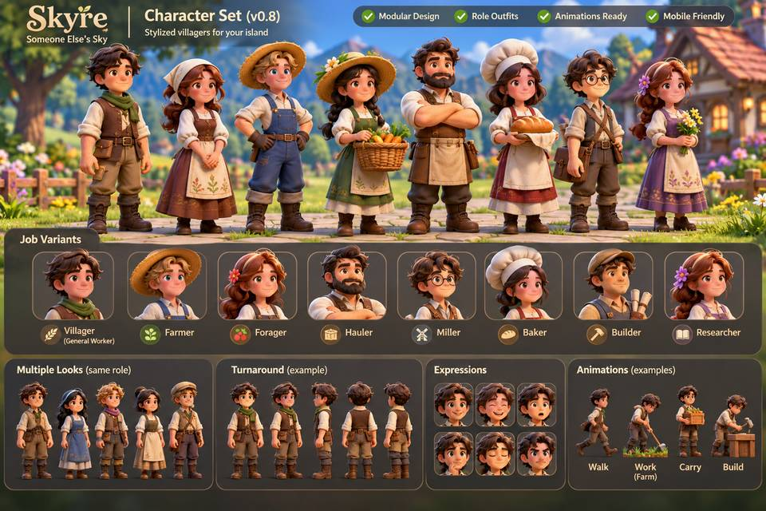

# Skyre character direction — v0.8

The image above is the **approved style reference**, generated during the Skyre design discussion. It is not a production mesh and cannot be directly animated in Three.js.

## Visual rules

- **Shape:** rounded storybook figures, slightly oversized heads, readable expressions, separate limbs and footwear.
- **Clothes:** soft woven shirts, leather work boots, vests and aprons, scarves and hats. Job roles change clothes, not character identities.
- **Palette:** honey, moss, teal, faded rose, cream, straw and weathered wood. Keep outlines legible against greenery.
- **Gameplay readability:** the farmer wears a straw hat; the baker has a pale chef hat; haulers carry parcels; millers and foragers wear work aprons.
- **Variation:** stable looks derived from worker ID. New game and saved game use the same deterministic face design. No user profile or sensitive data is needed.
- **Motion:** quiet idle breathing/head turns, alternating legs/arms while walking, parcel visibility when carrying.
- **Future assets:** replace procedural bodies with low-poly textured `.glb` models with authored animations and LODs. Keep the game’s worker logic independent of visual assets.

## Current implementation

- `character-design.js` defines the appearances and outfits (testable without graphics).
- `characters.js` constructs 3D villager rigs with shared material and geometry caches.
- `scene.js` reuses character rigs between refreshes and drives animation from existing worker paths.
- Mobile users can use the **Meet villagers** view to inspect details, and **Full screen** for an immersive play area. On browsers without the Fullscreen API, the UI uses a viewport-filling CSS fallback.

### Performance target

The scene currently renders up to 18 detailed villagers per viewed world. Prioritize sharing cached materials/geometry, avoid shadows on each villager mesh, and profile actual devices before raising that limit. If a more detailed sculpted model set is introduced, add lower-detail versions for far-away characters.
